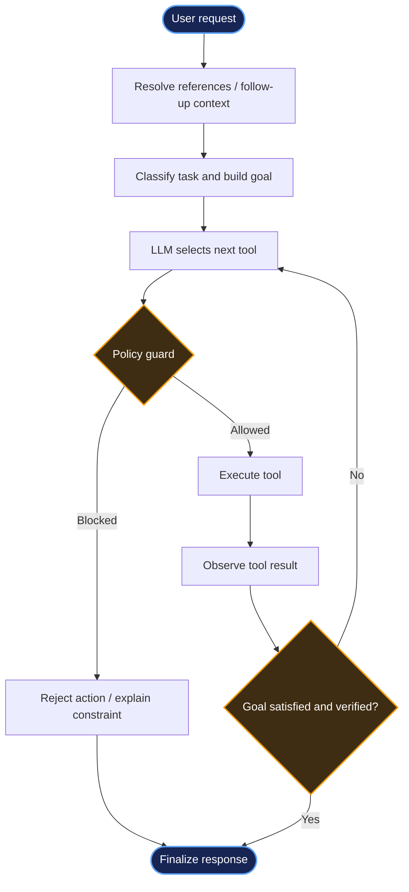

<div align="center">

# ⚡ Automated Agent System

### A goal-driven AI agent for invoice workflows, financial operations, and live information retrieval

<p>
  
  
  
  
</p>

**Reason → Act → Observe → Verify**

*An extensible agent that turns natural-language requests into multi-step tool workflows, with policy checks and human approval for sensitive actions.*

</div>

---

[](https://github.com/Abhinav-frfr/Automated-Agent-System)

## ✨ Overview

**Automated Agent System** is a tool-using AI agent designed to interpret user requests, select appropriate tools, execute multi-step workflows, and verify outcomes. It brings together local document processing, structured business records, external information retrieval, and approval gates in one workflow.

The system is designed around a key principle: **the LLM proposes actions; deterministic Python logic enforces business rules and safety constraints.**

### What it can do

- 📄 **Invoice workflows** — search and read invoice PDFs, aggregate invoice information, submit records, and verify stored invoice data.
- 💳 **Payment workflows** — inspect payment history and require explicit human approval before sensitive payment execution.
- 📈 **Stock workflows** — discover relevant company/ticker information and retrieve market data through browser-based tools where configured.
- 💱 **Foreign exchange** — query exchange rates through an external API.
- 🧰 **Tool-driven execution** — choose tools dynamically, inspect results, and continue until the task is complete or a limitation is reached.
- 🛡️ **Guarded actions** — combine prompt rules, policy checks, and tool-level validation rather than trusting the model alone.

## 🌀 How it works

<div align="center">



</div>

> GitHub renders Mermaid diagrams natively. The diagram gives a high-level view; the exact tool sequence depends on the request and the agent's observations.

### Architecture at a glance

| Layer | Responsibility |
|---|---|
| **Reference resolver** | Uses session context to interpret follow-up requests and resolve references where possible. |
| **Task classifier** | Maps requests to supported task types and extracts relevant parameters into a goal specification. |
| **Agent loop** | Repeatedly selects a tool, executes it, observes the result, and decides what to do next. |
| **Policy guard** | Checks whether a proposed action is permitted for the current task and workflow state. |
| **Tool layer** | Connects the agent to PDFs, internal JSON-backed records, browser automation, and external APIs. |
| **Human approval gate** | Pauses sensitive financial operations until explicit approval is supplied. |
| **Verification and finalization** | Checks available business invariants and reports success, rejection, or incomplete execution. |
| **Session and trace data** | Stores workflow/session information and debugging artifacts, depending on configuration. |

## 🧠 Important design decisions

### 1. LLM reasoning, deterministic execution

The model is responsible for interpreting intent and choosing tools. Python remains responsible for policy checks, input validation, duplicate prevention, approval requirements, and business-state changes. This reduces reliance on the model to follow instructions perfectly.

### 2. Classify before acting

Requests are mapped to task types before execution. The resulting goal provides the agent with structured constraints—for example, whether a request is read-only or can modify business records. Classification is a critical safety boundary, so ambiguous or unsupported requests should fail safely.

### 3. Separate source documents from business records

Invoice searches and reads should use the original PDF files. Internal records are used for submitted invoices, payments, duplicate checks, and verification. Keeping these roles separate makes it easier to distinguish source evidence from application state.

### 4. Approval for sensitive operations

Financial actions must not be executed solely because the LLM requested them. The approval gate requires an explicit decision, and the execution tool should independently validate the approval and the action it authorizes.

### 5. Verify the result, not just the tool call

A successful tool response does not automatically mean the user’s goal is complete. The agent should check the resulting business state and clearly distinguish verified completion from partial execution or failure.

### 6. Use modular tools

Tools provide focused capabilities rather than allowing the model to perform arbitrary operations. This makes individual actions easier to test, validate, and replace as the project evolves.

## 🧩 Models, frameworks, APIs, and services

The following reflects the project configuration described for this implementation. Check your `.env`, `requirements.txt`, and tool modules for the exact versions and endpoints used in your checkout.

| Component | Role |
|---|---|
| **Python** | Agent orchestration, validation, tool implementation, and business logic. |
| **LangChain** | Chat-model integration and tool-calling workflow. |
| **ChatGroq / GroqCloud** | Hosted inference for the configured LLM. The model identifier is set in project configuration. |
| **Playwright** | Browser automation for web-based information retrieval. |
| **DuckDuckGo search** | Web search/discovery for relevant pages and company information. |
| **Foreign-exchange API** | External exchange-rate lookup; endpoint and availability depend on the configured provider. |
| **PDF invoice files** | Local source documents used for invoice search and extraction. |
| **JSON files** | Lightweight local persistence for invoice/payment/stock records, exchange-rate results, approvals, and debugging/session data where configured. |

**Secrets:** API keys and credentials belong in `.env`, not in source control. Keep `.env.example` limited to variable names and safe placeholders.

## 🚀 Setup and run

### Prerequisites

- Python installed (use the version supported by your `requirements.txt`).
- Git.
- A GroqCloud API key if using ChatGroq/Groq-hosted inference.
- A browser installation supported by Playwright for browser tools.
- Network access for external search and API-backed features.

### 1. Clone the repository

```bash
git clone https://github.com/Abhinav-frfr/Automated-Agent-System.git
cd Automated-Agent-System
```

### 2. Create and activate a virtual environment

**Windows PowerShell**

```powershell
python -m venv .venv
.\.venv\Scripts\Activate.ps1
```

**macOS / Linux**

```bash
python3 -m venv .venv
source .venv/bin/activate
```

### 3. Install dependencies

```bash
python -m pip install --upgrade pip
pip install -r requirements.txt
```

If browser tools require a Playwright-managed browser, install the browser configured by your project:

```bash
python -m playwright install
```

### 4. Configure environment variables

Copy `.env.example` to `.env` and fill in the values required by your configuration.

**Windows PowerShell**

```powershell
Copy-Item .env.example .env
```

**macOS / Linux**

```bash
cp .env.example .env
```

At minimum, configure the Groq API key and model name expected by your code. Add external API settings only when those tools are enabled. Do not commit `.env`.

### 5. Check project data

The repository layout shown in the project screenshot includes:

```text
Automated-Agent-System/
├── data/
│   ├── invoices/
│   │   ├── amazon_august.pdf
│   │   ├── amazon_july.pdf
│   │   ├── amazon_september.pdf
│   │   ├── openai_august.pdf
│   │   ├── openai_july.pdf
│   │   └── openai_september.pdf
│   ├── sessions/
│   ├── approvals_log.json
│   ├── exchange_rates.json
│   ├── internal_db.json
│   ├── paid_invoices.json
│   └── purchased_stock.json
├── evaluation/
├── tests/
├── tools/
├── .env.example
├── .gitignore
├── requirements.txt
└── README.md
```

Some filenames and folders may differ by branch or local configuration. Preserve the expected data paths used by your tool modules. Use sample/test data when experimenting with write or payment workflows.

### 6. Run the agent

The screenshot confirms the repository root and virtual environment, but does not show the Python entry-point filename. Run the entry point defined by your project. For example, if the application exposes `main.py` at the repository root:

```bash
python main.py
```

If your entry point is in a package, use its actual module path instead, for example:

```bash
python -m <package>.main
```

**Tip:** If you are unsure which command is correct, inspect the project’s `readme.md`, entry-point file, or `pyproject.toml`/scripts configuration. Avoid running multiple instances against the same JSON-backed data while write operations are enabled.

## 🧪 Testing and evaluation

Run the tests present in the repository:

```bash
python -m pytest
```

If `pytest` is not installed or the project uses a different test runner, follow the dependencies and commands defined by the repository.

Useful end-to-end scenarios include:

- Search for an invoice and confirm that the result matches the source PDF.
- Submit an invoice and confirm duplicate submissions are rejected.
- Attempt a payment without approval and confirm execution is blocked.
- Approve a payment and verify the resulting payment record.
- Submit malformed or unsupported requests and confirm the agent fails safely.
- Simulate a browser/API failure and confirm the workflow times out or reports an actionable error.

For financial actions, test against disposable sample records rather than real payment systems.

## ⚠️ Known limitations

- **Classification sensitivity:** downstream behavior depends on correct task classification and parameter extraction. Unfamiliar phrasing can cause misclassification.
- **Local JSON persistence:** JSON files are simple for a demo, but are not a substitute for transactional storage under concurrent writes. Use database transactions and uniqueness constraints for stronger guarantees.
- **Browser fragility:** external page layouts, consent prompts, network errors, rate limits, and CAPTCHAs can interrupt data extraction. CAPTCHA encounters should stop safely or request human intervention.
- **External dependency availability:** hosted model inference, search providers, and exchange-rate APIs can fail, change behavior, or impose rate limits.
- **Human approval interface:** a console-based approval gate is suitable for a local prototype, but is not a production approval workflow.
- **Observability:** stdout and debug logs may not provide a complete structured trace or deterministic replay of every run.
- **Verification coverage:** correctness depends on the invariants implemented for each task; a tool returning successfully is not sufficient proof of end-to-end success.
- **No production guarantee:** the project is a prototype and should not be connected to real financial execution without security review, robust persistence, authorization, audit logging, and comprehensive testing.

## 🧾 Assumptions

- Invoice PDFs and local records are sample/demo data and are accessible to the running process.
- The configured LLM supports the tool-calling behavior expected by the agent integration.
- Network-dependent tools are enabled only when their credentials, endpoints, and dependencies are configured.
- Approval is an explicit authorization step, not a replacement for authentication, role-based access control, or transaction-level validation.
- Stock and foreign-exchange outputs are informational and may be delayed or unavailable; they should not be treated as financial advice.
- Local data files are writable and their paths match the project configuration.
- Tool names, model identifiers, API endpoints, and run commands can vary across branches; verify them against the checked-out source.

## 🔐 Security notes

- Never commit `.env`, API keys, access tokens, or real financial data.
- Keep `.env.example` free of secrets.
- Validate and scope every approval to the exact action and parameters being approved.
- Enforce duplicate protection and business constraints inside the tool/database layer, not only in prompts.
- Add timeouts and bounded retries to network and browser tools.
- Treat retrieved web content and document text as untrusted input.
- Do not use the prototype for real payments without a formal security and reliability review.

## 🗺️ Roadmap

- [ ] Golden evaluation set with classification precision/recall and end-to-end pass rate.
- [ ] SQLite-backed transactional storage and stronger idempotency.
- [ ] Structured traces for decisions, tool calls, latency, and failures.
- [ ] More resilient browser tools with timeouts and fallback sources.
- [ ] Web/Slack approval workflow with authenticated callbacks.
- [ ] Session-memory summarization and token/cost tracking.
- [ ] Split orchestration, policies, session handling, and recovery into separate modules.

## 🤝 Contributing

1. Create a feature branch.
2. Keep tools focused and validate inputs at the tool boundary.
3. Add or update tests for new behavior and safety constraints.
4. Never include secrets or private invoice data in commits.
5. Submit a pull request with a concise description and test results.

---

<div align="center">

**Built as an exploration of tool-using agents, guarded automation, and verifiable workflows.**

<sub>For research and demonstration use. Review all actions and outputs before relying on them.</sub>

</div>
